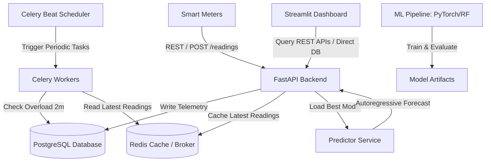
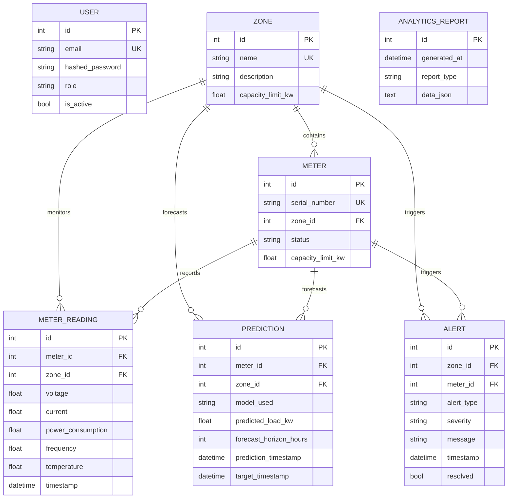

# Smart Grid Load Forecasting System

⚡ An industrial-grade, AI-powered load forecasting and overload detection platform for smart grids.

This system ingests real-time smart meter telemetry (voltage, current, power consumption, frequency, temperature) and uses advanced time-series forecasting models to predict load conditions 1h, 6h, and 24h into the future, triggers automatic safety alerts if loads exceed capacity limits, and serves real-time analytics.

https://wvueap42vey42vomcsbgep.streamlit.app/
---

## 🏗️ System Architecture



---

## 🗄️ Database ER Schema



---

## 📁 Folder Structure

```
smartgrid-load-forecasting/
├── app/
│   ├── api/                  # API Routers (v1)
│   ├── core/                 # JWT Authentication & security utilities
│   ├── db/                   # SQLAlchemy engine session & registry
│   ├── models/               # SQLAlchemy database models
│   ├── schemas/              # Pydantic validation schemas
│   ├── services/             # Cache and analytics service logic
│   ├── tasks/                # Celery & Celery Beat background tasks
│   ├── ml/                   # Machine learning data processing, models & training
│   ├── config.py             # Settings loader via pydantic-settings
│   └── main.py               # FastAPI entrypoint
├── dashboard/
│   └── dashboard_app.py      # Streamlit visualization app
├── data/
│   └── sample_meter_data.csv # Generated historical telemetry CSV
├── scripts/
│   └── generate_sample_data.py # Database seeder & synthetic generator
├── tests/
│   ├── conftest.py           # Pytest test fixtures
│   └── test_api.py           # Integration API tests
├── Dockerfile                # Docker container build script
├── docker-compose.yml        # Multi-container deployment compose
├── requirements.txt          # Python dependencies manifest
└── README.md                 # Project documentation
```

---

## 🚀 Installation & Local Run

### Prerequisites
- Python 3.12 or newer
- Redis and PostgreSQL (Optional, fallback to SQLite and In-Memory cache is automatic!)

### Step-by-Step Setup

1. **Clone the repository and go to the project directory**:
   ```bash
   cd "smartgrid-load forcasting"
   ```

2. **Install dependencies**:
   ```bash
   pip install -r requirements.txt
   ```

3. **Generate Synthetic Data & Seed DB**:
   This generates a 30-day hourly synthetic dataset of load telemetry, seeds the SQLite database (`smartgrid.db`), and outputs `data/sample_meter_data.csv` for ML training.
   ```bash
   TESTING=1 python3 scripts/generate_sample_data.py
   ```

4. **Train Machine Learning Models**:
   Trains Baseline, Linear Regression, Random Forest, LSTM, and Transformer models, outputs a performance comparison matrix, and serializes the best performing model.
   ```bash
   python3 app/ml/train.py
   ```

5. **Run the FastAPI REST Server**:
   ```bash
   TESTING=1 uvicorn app.main:app --host 127.0.0.1 --port 8000 --reload
   ```
   - Swagger documentation is available at `http://127.0.0.1:8000/docs`.

6. **Run the Streamlit Dashboard**:
   ```bash
   streamlit run dashboard/dashboard_app.py
   ```
   - The dashboard interface is available at `http://localhost:8501`.

---

## 🐳 Docker Deployment

To launch the complete production system with PostgreSQL, Redis cache, FastAPI server, Celery worker, Celery beat, and Streamlit in Docker containers:

```bash
docker-compose up --build
```

- **FastAPI Endpoint**: `http://localhost:8000`
- **Swagger Documentation**: `http://localhost:8000/docs`
- **Streamlit Web Panel**: `http://localhost:8501`

---

## 🧪 Testing

Execute the automated integration tests verifying database integrity, ingestion, auth schemas, analytics caching, and load alerts:

```bash
TESTING=1 pytest tests/
```
